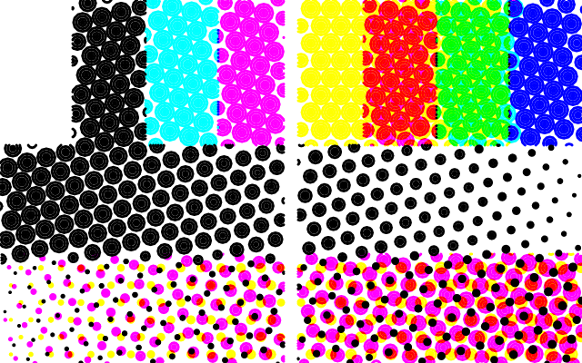
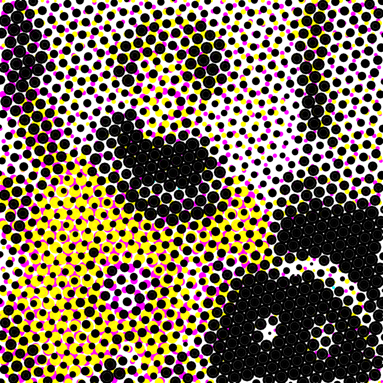
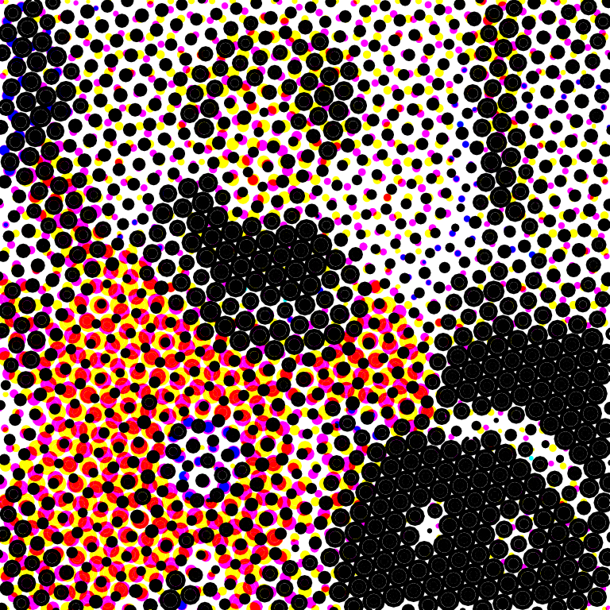

# CMYK Circles

CMYK Circles converts one selected bitmap into four overlapping, editable vector layers: Cyan, Magenta, Yellow and Black. The bitmap stays unchanged. Every layer retains the full source frame, blank margins, position, rotation and separate X/Y scales. Apply and Update commit the entire four-layer result, including the optional border, in one undo step.

## Install and try it

This plugin requires the engine additions on the `codex/cmyk-circles` branch of **shaboomi/terraForge**. Older TerraForge builds do not understand its pen dropdowns or ordered passes. Copying the plugin into an older build is insufficient.

1. For the supplied Windows test build, open `release/cmyk-circles/win-unpacked/terraForge.exe` from this repository. Keep the entire `win-unpacked` folder together. This is an unsigned unpacked build, not an installer. It uses the normal packaged-app profile; the automated checks use isolated temporary profiles.
2. Choose **Pens** and define your actual Cyan, Magenta, Yellow and Black pens. Four distinct pen IDs are required even when an image leaves a channel empty. Ink colours should correspond to the channel you assign them to.
3. Choose **Plugins → Open Plugin Folder**. Copy `cmyk-circles.tf-plugin.js` from the supplied ZIP or `docs/examples/` into that folder. Restart TerraForge. Development and packaged builds use different plugin folders; always use the menu to open the correct one.
4. Import a PNG or JPEG and select the bitmap itself. Choose **Plugins → Bitmap to Vector → CMYK Circles**.
5. In Properties, assign all four real pens. A unique pen with the exact configured colour `#00ffff`, `#ff00ff`, `#ffff00` or `#000000` is suggested automatically. Other shades, ambiguous matches and missing saved IDs require an explicit choice. Suggestions never create pens or select an unrelated closest colour.
6. Choose **Preview**, inspect the temporary artwork, then **Apply artwork**. You can minimise the panel without losing a valid preview. Close or Cancel preview discards it. A preview cannot be saved, selected, exported or plotted.
7. Select any generated layer and choose **Edit with CMYK Circles** to restore its saved settings. Choose Preview and **Update artwork** to replace all four layers together. Undo restores their preceding geometry and settings. This also works after saving/reopening a `.tforge`, provided the plugin and original source are still available.

You do not need to use GitHub to try the supplied Windows build. To incorporate the engine changes into your fork, open the supplied pull request, review its changes/checks, then use GitHub's **Merge pull request** button when satisfied. The pull request's base and head are both in `shaboomi/terraForge`. There are no upstream changes.

## If you see a detail-budget error

An image's pixel resolution determines the number of generated paths. Shrinking its width/height on the canvas changes physical mark sizes but does not reduce the path count. Filled 8 px circles with 1 px fill spacing can exceed the fixed 10,000-path / 100,000-point limits even on ordinary images.

Enable **Fit complete image to detail limits (enlarges circle settings)** in Properties and Preview again. The option is off by default so requested physical settings and existing saved results retain their exact meaning. Fitting first tries the exact request; only if a detail limit is reached does it restart the entire four-layer calculation with circle diameter, gap, fill spacing and chord error multiplied together by 2, 4, 8, etc. It reports the effective settings in the preview message. Offsets, angles, source frame, transforms and border width stay unchanged. The fields retain the requested values, and the fitting choice is saved with the result. Repeating an update is deterministic.

Fitting reduces geometric detail; it does not raise the engine limits or return unfinished layers. Invalid pens and cancellation still fail immediately. All attempts share the same runtime deadline. If fitting cannot produce a complete result, it fails with guidance rather than applying partial work. With Fit off, errors identify the particular point/path/grid/sampling limit and source dimensions; reducing Sampling detail helps sampling work, but does not directly reduce the output point budget.

A 620×800 colour photograph was verified at 92.579×119.457 mm: fitting used 4× circle settings (32 px diameter, 4 px gap/fill spacing, 0.8 px chord error) and returned all four layers at 3,895 paths / 46,128 points. At that placement, the effective maximum diameter is approximately 4.78 mm. The factor depends on the actual image and settings, including transparency boundaries.

## Controls and defaults

All length controls use **source pixels**, not screen pixels or machine speed. If the image's local-to-page X scale is 0.25 mm/px, an 8 px circle is 2 mm wide, a 1 px gap is 0.25 mm, a 2 px X offset is 0.5 mm, and a 3 px border band spans 0.75 mm in X. Y uses its own scale. Increasing the bitmap's displayed size increases all these physical dimensions together. Independent X/Y resizing creates elliptical marks and scales the border differently on horizontal and vertical sides. Rotation rotates the complete result with the source. Changing the image's pixel resolution while keeping its displayed dimensions changes the physical meaning of these settings; preview again.

| Control | Default | Meaning |
| --- | --- | --- |
| Cyan / Magenta / Yellow / Black pen | Exact-colour suggestion, otherwise choose | Stable IDs from your configured Pens. Four distinct IDs; Black also draws the border. Missing saved pens are not replaced. The plugin does not reorder the global pen list. |
| Fit complete image to detail limits | Off | If needed, enlarges the circle settings together until complete output fits; the preview reports actual sizes. Off requires exact settings. |
| Circle size | 8 source px | Maximum diameter. |
| Tone controls circle coverage | Reduce individual circle area | Radius = maximum radius × square root of sampled ink coverage, so geometric circle area follows tone. White produces no circle. |
| Same size circles | Optional tone mode | Keeps the maximum diameter and uses deterministic 8×8 ordered screening to vary circle population. Low coverage can quantize to zero; very small features may be missed. |
| Circle style | Filled | Filled draws separate concentric polyline rings. Outline draws only each perimeter. No SVG fill substitutes for toolpaths. |
| Circle spacing | 1 source px | Gap at maximum diameter. Centre pitch is diameter + gap. Alternate rows shift by half that pitch; row pitch is pitch × √3/2. Smaller tone-controlled circles leave larger gaps. |
| Fill spacing | 1 source px | Maximum radial distance between fill rings, and between rectangular border contours. Choose in relation to the physical pen width at the intended scale. A pen narrower than this spacing leaves gaps; wider pens spread beyond the path centrelines. Outline circles ignore it, but the border still uses it. |
| Black generation / undercolour removal | 100% | Moves the common CMY component into K. At 0%, neutral tones use CMY; at 100%, neutral tones use K only. Intermediate settings share ink between channels. |
| Each layer's X/Y offsets | 0 source px | Independent registration/grid translations along source X/Y, applied after screen rotation. They shift the grid relative to the bitmap; the bitmap and its frame stay put. |
| C / M / Y / K screen angle | 15° / 75° / 0° / 45° | Rotates the whole staggered grid around the source-frame centre. Positive angles appear clockwise in source coordinates because Y increases downward. Rotating an individual circle would have no effect. |
| Add border | Off | Draws an inset rectangular band using K during its final pass. This deliberately adds ink on opaque white margins. Fully transparent cells stay empty even in the border. |
| Border width | 3 source px | Toolpath band depth measured inward from all frame edges. Contours include the frame boundary and the specified inner band boundary. Must be less than half the shorter frame side. It changes real plotted geometry, not canvas stroke thickness. |
| Sampling detail | 2 samples per axis | A 2×2 stratified average of separated ink coverage over each circle-sized grid cell. Allowed integer range: 1–4. More sampling can reduce aliasing, but does not increase plotter speed. |
| Circle curve detail | 0.2 source px chord error | Maximum polygon sagitta for each circle perimeter. Smaller values add vertices. This is geometric accuracy, separate from plotting feed rate. |

Actual ink extends roughly half a physical pen width beyond toolpath centrelines. The requested border band describes its contour span; exact deposited width needs a known pen nib and paper. The canvas stroke-width control is a display aid, not a replacement for border contours or circle fills. The source bitmap's display opacity is not multiplied into its original image alpha: its normalized RGBA pixels drive separation, consistent with Stage 3.

## Separation and clipping

The documented basis is [Adobe's PDF 1.7 / ISO 32000-1, section 10.3.2, RGB to CMYK](https://developer.adobe.com/document-services/docs/assets/35e4369068f86065372c18787171a17e/PDF_ISO_32000-1.pdf). With straight sRGB samples normalized to 0–1 and alpha `a`, first composite over white:

```text
R = a*r + (1-a), G = a*g + (1-a), B = a*b + (1-a)
c0 = 1-R, m0 = 1-G, y0 = 1-B
k = min(c0,m0,y0)
K = generation*k
C = c0-K, M = m0-K, Y = y0-K
```

Here the black-generation function and undercolour-removal function are both `generation*k`, bounded by 0–1. The residual components stay nonnegative. This is the Adobe subtractive model with a stated BG/UCR choice, not an ICC-profiled press separation or a normalized CMYK colour-picker formula. Separation happens per sampled pixel before averaging the grid cell's coverage. It does not select a nearest pen for source pixels. At full black generation, opaque black is K-only, white has no marks, cyan/magenta/yellow use their corresponding inks, red uses M+Y, green uses C+Y and blue uses C+M.

Every polyline edge is clipped to the rectangular bitmap frame by intersections. A pixel-cell traversal checks every crossed pixel and breaks the path at zero-coverage cells or fully transparent cells, including one-pixel slits. It never joins separate circles, fill rings or excluded intervals. The optional border uses the alpha mask rather than channel coverage, so it can draw on opaque white. Output geometry is mapped to the original complete source-local frame; only the host applies placement/transforms.

All four layers are retained even when some or all have zero paths. An opaque white or wholly transparent source with border off therefore adds four empty editable layer entries and **no ink**. Empty layers contribute nothing to G-code. This makes future settings updates consistent without inventing invisible/dummy marks.

## Export and pen changes

The engine stores each output's optional `plotOrder` in saved provenance and carries it into G-code. CMYK uses C=0, M=1, Y=2, K=3. Optimization operates inside each ordered pen pass. Path joining is disabled for a job containing ordered output so excluded gaps remain pen-up moves. K and its border are the final CMYK pass regardless of colour brightness, import order or global pen order. Ordinary line artwork in a mixed job is processed before the ordered passes. A combined job containing point-tap artwork is rejected with instructions to export those taps separately, so they cannot follow K.

Use either:

- **Combined output:** the file's real drawing paths and `;@tf` pen/layer markers follow C → M → Y → K. These markers identify real pen IDs; they do not operate an automatic pen changer or insert manual pen-change pauses. Use separate files for an ordinary single-pen plotter.
- **Split output into separate files → Export one file per group:** outputs are produced in that same order with numbered filenames such as `1-Cyan`, `2-Magenta`, `3-Yellow`, `4-Black` (and optional `_opt`). Run the files in numbered order and change to the matching physical pen between them. Empty channels produce no file. Saving files cannot enforce the order in which a person later starts them.

Colour-based splitting can combine distinct real pens that share a display colour; SVG-layer splitting can omit these generated imports. The engine therefore reports a clear instruction to choose combined or per-group output when either unsupported split mode is selected for ordered plugin artwork. Missing real pen assignments and vinyl-cutting mode are rejected. The app never sends this plugin's output to a physical plotter during verification.

## Artwork previews and limitations



Top row: white, black, cyan, magenta, yellow, red, green, blue. Middle: grey gradient. Bottom: partial-alpha colour over white. The vertical transparent slit remains empty. These marks are generated vector toolpaths, with no source bitmap underneath.





The normal RGB preview is what ordinary coloured path overdraw can represent. The separate ideal-ink image rasterizes the **same generated paths** per ink, then multiplies ideal CMY/K transmittance on white. It illustrates subtractive overlap; it is not a prediction of your pens. Physical results depend on ink transparency, spectral response, pen width, paper, drying, repeat passes and registration. Opaque pens can cover previous inks. Real pens do not have ideal process-ink spectra. There is no ICC calibration, dot-gain compensation or registration sensing.

Maximum circles with a positive gap do not cover the whole page even at 100% ink: staggered circular packing leaves paper between marks. Outline mode has a different tonal response from filled circles. Sampling misses features smaller than its cell; equal-size mode adds screen quantization. Rotated grids can create visible screen/moire patterns. Clipping changes circular shapes near edges and colour/alpha boundaries. Unequal scaling can amplify polygon error and fill spacing.

The detailed NASA colour photograph is processed at 384×384 pixels with diameter 12, fill spacing 2.5 and chord error 0.3: **6,279 paths / 76,091 points**, all four channels complete. Fine filled screens on large photographs can exceed the limits. See the [statistics and exact settings](images/cmyk-circles/statistics.json), [photograph source](images/cmyk-circles/photograph-source.png) and [editable generated SVG](images/cmyk-circles/photograph.svg). The source photograph is the existing public-domain NASA Eileen Collins fixture; [original fixture attribution](images/spiral-sawtooth/README.md#portrait-attribution) is preserved.

Limits remain 10,000 paths and 100,000 points across the complete output, with a bounded cell/segment workload, a 25-second cooperative deadline and the host's 30-second termination deadline. Progress and cancellation are supported. Excessive requests fail the whole run with guidance; no partial layer set is applied. Enable Fit complete image to detail limits, increase diameter/gap/fill spacing/chord error, lower sampling detail for sampling-work limits, or use Outline. A lower-resolution source copy may help; the plugin never resamples or overwrites your source itself.

## Verification — 28 October 2026 (New Zealand)

- Unit tests execute the distributable itself: white/black/CMY/RGB, overlapping M/Y geometry, gradients, black generation, partial/full alpha, white and transparent slits, rectangular bounds, real ring fills, actual border band contours, grid staggering, independent offsets and screen rotations, deterministic output, progress, cancellation and budget rejection.
- Worker tests inspect emitted G-code with optimization on/off and joining requested: C/M/Y/K order, separate pen lifts and distinct real IDs even with identical display colours.
- Desktop tests use the installed file in an isolated profile: Bitmap to Vector menu, exact-colour suggestions, duplicate-pen rejection, Preview isolation, minimise/expand/close, four-layer Apply/Update, original image/assets and unequal transforms, global pen order preservation, atomic undo/redo, saved settings/reopen, optimized combined export, and numbered per-pen export.
- Typecheck, production build and the broader regression suite cover Stage 3, Spiral Sawtooth, resizing, pen/paper controls and plot-completion behavior. Three existing locally deleted example files are preserved; their dependent example test file is excluded from the broad run.
- The unpacked Windows build is checked with the same isolated desktop test; no physical plotter is connected or operated. Packaging is unsigned and is not an installer/upgrade test.

Rebuild previews with `node scripts/cmyk-circles-previews.mjs`. Run focused checks with `npm test -- tests/unit/cmykCircles.test.ts tests/unit/svgWorker.test.ts`. Run the desktop checks with `node node_modules/@playwright/test/cli.js test --config=tests/e2e/playwright.config.ts tests/e2e/cmyk-circles.spec.ts`. To target the unpacked app, set `TERRAFORGE_CMYK_EXECUTABLE` to its absolute executable path for that command.
