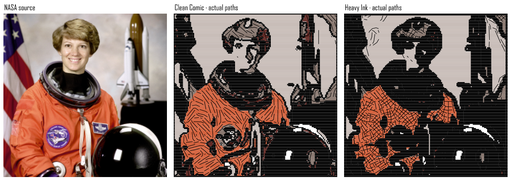
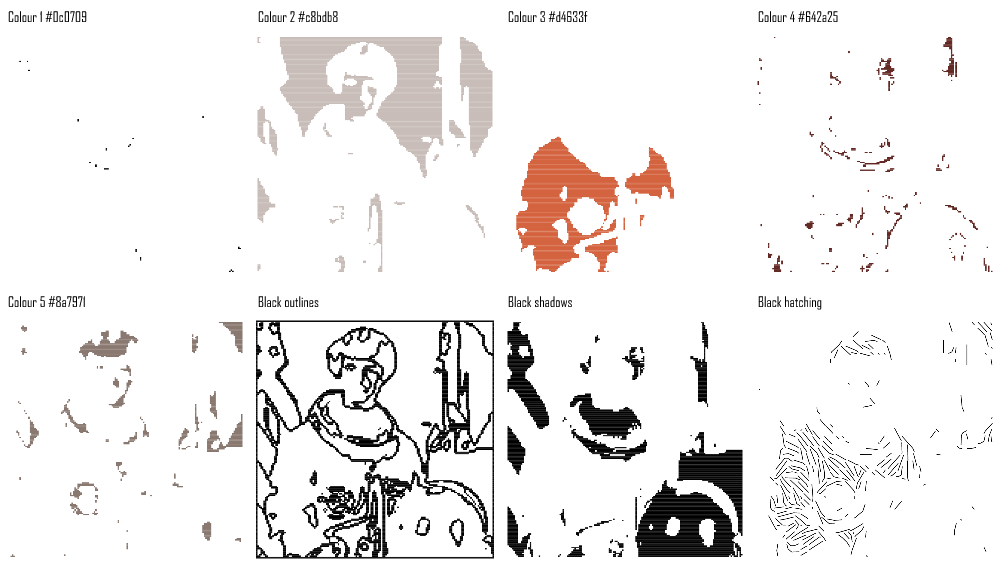
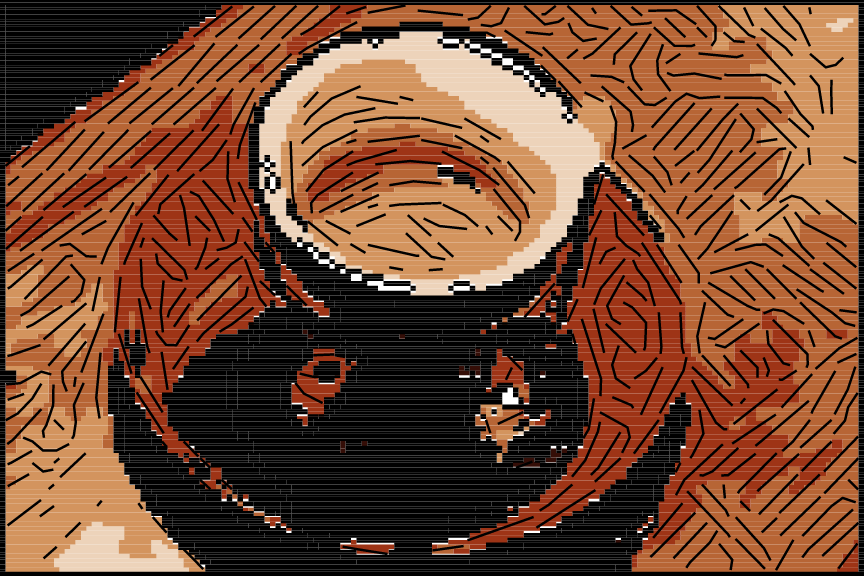

# Comic Ink Vectorizer

Comic Ink Vectorizer turns one selected photograph into a small palette of named vector separations, bold black outlines, deep black shadows and directional hatching. Everything returned is an editable polyline: colour and shadow coverage consists of actual pen strokes, with no embedded bitmap in the conversion. The original photograph stays untouched.

It runs locally and offline in TerraForge's existing isolated plugin worker. No cloud account, image upload, AI credentials or additional runtime packages are needed. This release uses the existing API; no host changes are necessary. It requires a TerraForge build that supports [shared bitmap preparation](plugin-bitmap-preparation.md), including the current repository build. An older Stage 3 application without preparation support needs updating.

## Install — no GitHub experience needed

1. Open the supplied `Comic-Ink-Vectorizer-1.0.0.zip` and choose **Extract all**. Alternatively use [comic-ink-vectorizer.tf-plugin.js](examples/comic-ink-vectorizer.tf-plugin.js) directly. On GitHub, open that file and choose **Download raw file**; saving the webpage does not install the plugin.
2. Start TerraForge. Choose **Plugins → Open Plugin Folder**.
3. Copy **only** `comic-ink-vectorizer.tf-plugin.js` into the folder that opens. Keep its full filename; do not add `.txt`. Install one copy only, because duplicate plugin IDs are rejected.
4. Choose **Plugins → Rescan Plugins**. If your app lacks that action, close and reopen it. Installed applications and development builds use different folders, so always use Open Plugin Folder.
5. Import a PNG or JPEG and select the image itself. Choose **Plugins → Bitmap to Vector → Comic Ink Vectorizer**. The controls appear in Properties; scroll within the panel to reach the actions.
6. Start with **Clean Comic**, the automatic palette and **Processing long edge 160**. Choose **Preview**, inspect it, then choose **Apply artwork**. Hide the source image using its eye control to inspect just the generated vectors.
7. Save your layout as `.tforge`. To revise an applied result, select any of its generated items and choose **Edit with Comic Ink Vectorizer**, change controls, **Preview**, then **Update artwork**.

There is no need to make a GitHub account, create a branch, submit a pull request or run commands to install the plugin. Copying its JavaScript file installs it into a compatible app. If your app says shared bitmap preparation is unsupported, obtain a current TerraForge build; a plugin file cannot add missing host features. Developers can run `npm.cmd install`, `npm.cmd run build`, then `npm.cmd run dev` from this repository.

Apply and Update change the entire generated group in one undoable operation. Undo restores the preceding geometry and settings. The source frame, empty margins, position, rotation and separate X/Y scales are retained. Opening a layout does not execute code. Saved vector geometry remains visible and usable if the plugin is removed. Regeneration requires the original source and the same installed/enabled plugin version; it replaces manual geometry edits in the generated group. Minimise preserves a valid preview; Close or Cancel preview discards temporary work.

## Output items and pens

Each **nonempty** colour separation becomes a named item such as `Colour 3 #d4633f`. Black marks have separate items named **Black outlines**, **Black shadows** and **Black hatching**. Empty passes are omitted; no dummy marks are inserted. With at most eight palette colours there are at most eleven items. These are ordinary named vector items, TerraForge's supported equivalent for this workflow, rather than new document layers or an SVG effects stack.

The automatic palette, shared preparation channels and pen-colour palette are colour choices, not pen assignments. Colour items deliberately remain unassigned, including when sampling **My pen colours**. After Apply, place them into the desired real pen groups using TerraForge's Groups controls. For exact colour channels, supply your pen colours through **My pen colours**. **Assign black ink to real pen** is an optional explicit assignment for all three black items; leaving it blank keeps black unassigned. Changing the selected pen's actual colour changes its displayed and plotted colour, including when a non-black pen is deliberately selected. The plugin never chooses a pen changer or plotting order.

## Controls

All distances below refer to the bounded **working grid**, not source pixels, millimetres or machine speeds. Processing long edge changes that grid, so it changes the physical size of these marks. Increasing artwork size after Apply also increases spacing; unequal X/Y scaling stretches it in each direction.

| Control | Default | Effect |
| --- | --- | --- |
| Style preset | Clean Comic | Clean uses the controls as entered. Heavy Ink adds 24 to a nonzero shadow threshold, multiplies outline strength by 1.5 before raster rounding and hatch darkness by 1.2 (capped at 100). Fine Hatching uses 0.7× hatch spacing and longer strokes. Presets modify the entered settings rather than rewriting their controls. |
| Palette size | 5 | Maximum automatic colours, 2–8. A manually chosen palette must contain no more than this number; unused colours are omitted. Black ink is additional. |
| Colour palette | Automatic | Deterministic colour clustering; reuse the shared preparation palette; or sample the configured real pens' colours. Every mode leaves colour items unassigned. |
| Colour simplification | 45 | Stronger boundary-aware colour smoothing and merging of similar neighbouring labels. Higher values also suppress weaker interior contours. |
| Processing long edge | 160 px | Area-samples the whole image to a maximum dimension of 32–512, never enlarging small inputs. Start low, then increase only if capacity allows. |
| Outline strength | 1 working px | Thickens the exterior and selected interior contour bands. Zero disables them; subpixel values and dilation are rounded on the working grid, so some adjacent slider values produce the same band width. |
| Shadow brightness threshold | 58 | Prepared brightness below this value forms separate black masses. Higher values make larger masses. Zero disables shadows in every preset. |
| Artistic hatch darkness | 50 | Extends hatching into lighter midtones as it increases; zero disables artistic hatching. It does not change colour coverage spacing. |
| Artistic hatch spacing | 4 px | Distance between seeds for short directional strokes; smaller values increase marks and detail. |
| Hatch direction | Smoothed image direction | Smoothed brightness-gradient tangents where sufficiently coherent; fixed angle elsewhere. Fixed angle mode uses the selected angle throughout. |
| Hatch angle / fallback | 45° | Clockwise angle from the image's horizontal axis. Used for fixed hatching and low-confidence areas. |
| Crosshatch darker midtones | Off | Adds an orthogonal second pass only in darker eligible midtones. Its crossings are intentional; parallel neighbouring strokes use an occupancy mask to avoid retracing. |
| Minimum colour / shadow region | 6 px area | Merges small connected colour islands into neighbouring colours, removes small isolated shadow islands, and leaves excluded background holes open. This is an area threshold, not stroke length. |
| Path simplification | 0.25 px | Maximum chord deviation for short curved hatch strokes. Every shortcut is checked against the exclusion mask. Straight coverage runs already contain only two points. |
| Background handling | Preserve transparency; omit near-white | Excludes fully transparent areas and adjusted near-white pixels (all RGB components ≥246). **Preserve transparency; draw white** includes opaque white as drawable colour coverage. **Composite transparency on white; draw white** intentionally covers transparent regions with white too. |
| Output mode | Plot-ready colour and ink | Colour coverage plus the three black passes, or black ink passes alone. Both modes return strokes suitable for plotting. |
| Colour coverage spacing | 0.85 px | Controlled horizontal fill strokes inside each colour mask; increasing it makes a visibly more open screen. |
| Dense black coverage spacing | 0.45 px | Denser strokes for both outline bands and shadow masses. Kept independent from artistic hatching. |
| Assign black ink to real pen | Blank | Explicit optional real pen assignment. Saved missing pens require correction; no silent replacement. |

Use the host's existing **Artwork capacity** selector for Standard or Extended 6×. Levels, Gamma, Contrast and Smoothing live in **Shared bitmap preparation**, and are saved alongside plugin settings. Prepared brightness controls shadows, edges and hatching. The colour branch applies the same levels/gamma/contrast to original RGB and then its own edge-preserving smoothing; host Smoothing affects prepared brightness, not that independent colour branch. No second levels/gamma/contrast controls are added.

Leave host **Colour separation** at Tones only for automatic or pen palettes. To reuse chosen colours, select **Selected colours** in the shared controls, enter up to eight `#RRGGBB` colours, then set the plugin Colour palette to **Shared preparation palette**. This reuses the colours, not the host's darkness-weighted channel amounts. CMYK/RGB prepared channels are not recombined or separated again. They are unnecessary for this algorithm; a warning explains when they are unused.

## Screen appearance and physical plotting

TerraForge's plugin geometry supports closed polylines, but does not expose true compound filled regions, filled holes or arbitrary SVG markup. Closing a boundary alone would plot an empty shape. This plugin therefore returns coverage strokes for colours, denser coverage for black outlines/shadows, and separate artistic hatch strokes. It does not advertise a filled-vector mode that the host cannot carry through this workflow. No host extension is required to provide the requested plot coverage.

Choose real nib widths and artwork size together. For example, at a 100 mm square output from a 160×160 working grid, each working pixel is 0.625 mm. Default colour spacing becomes about **0.531 mm**, black spacing **0.281 mm**, and artistic seed spacing **2.5 mm**. A 0.6 mm colour pen and 0.35 mm black pen can overlap adjacent coverage strokes at that size; a much thinner pen leaves visible stripes. These are spacing examples, not ink calibration. With a non-square image use physical width / working width for X and physical height / working height for Y; horizontal coverage row spacing follows Y.

The colour and deep black masks exclude outline bands. Artistic hatch segments exclude outline bands and deep shadows. Shared colour borders become one ink mask, avoiding duplicate outlines per colour. Pixel-cell traversal clips every coverage run and hatch segment at holes and mask boundaries; simplification cannot bridge a hole. Thick physical nibs can still protrude beyond geometric boundaries or close very small holes. Use an appropriately fine pen or larger artwork where that matters. Crosshatching has deliberate intersections, and artistic black strokes overlay colour coverage as actual ink would.

Use normal pen/group export and inspect the G-code path preview before sending a job. Leave additional host hatching disabled on these generated items; they already contain their fill strokes. The first release does not prescribe a black-last execution sequence. No physical plotter was operated during validation.

## Examples and visual limits







The [example folder](images/comic-ink/README.md) includes full vector SVGs, individual separation PNGs, a synthetic fixture with known holes, statistics and source attribution. Every conversion preview renders the plugin's actual paths with `fill="none"`; no source bitmap or filled-shape substitute is underneath. Illustrative nib widths are documented there. The comic reference is used only to guide visual characteristics; its image, lettering and characters are not included in the package or copied into conversions.

This is a deterministic stylisation, not a professional illustrator's interpretation. Image tangents only approximate form-following hatching: gradients do not reveal real surface geometry. Shadows are thresholded image tones rather than inferred lighting. Clustering can lose skin tones, flatten facial expressions and mistake busy backgrounds for important contours. Heavy Ink deliberately sacrifices small features. The working grid produces stepped boundaries; smooth curves, semantic subject/background separation and hand-directed anatomy are outside this release.

Transparent source pixels are conservatively excluded: if any fully transparent source pixel falls in a downsampled cell, that cell is excluded in preserve-transparency modes. This keeps one-pixel transparent slits open but can widen them and remove very fine visible features. Opaque highlight holes smaller than a reduced grid cell can disappear through averaging; use higher resolution when they matter. Fully transparent, excluded white, or ink-only images with no eligible marks return an actionable empty-output message.

## Algorithm and limits

1. Consume shared prepared brightness. Area-sample original RGBA to a maximum 512×512 grid, applying host colour levels, gamma, contrast and white compositing once, with explicit background exclusions.
2. Run two small bilateral RGB smoothing passes to suppress noise while retaining strong boundaries.
3. Cluster a bounded 5-bit colour histogram using weighted deterministic farthest-first centres and six refinement passes, or use the supplied palette. Label nearest colours, merge similar neighbours and clean connected islands without filling exclusions.
4. Build a separate deep-shadow mask from prepared brightness; clean isolated masses. Generate exterior bands, strong palette borders and important brightness edges into a single outline mask, then dilate for outline strength.
5. Smooth a double-angle structure tensor over 7×7 neighbourhoods. Use coherent tangent directions, otherwise the fixed-angle fallback. Short bounded streamlines blend successive orientations; darker areas can get an orthogonal crosshatch pass.
6. Convert the masks to clipped horizontal coverage runs. Clip streamlines using the same exact cell traversal and simplify with bounded deviation plus mask checks. Map all points back to the full input-local frame; TerraForge applies placement.

No randomness is needed; the host's saved seed remains available through the standard workflow. The same pixels and settings produce the same paths. Typed planes and histograms are bounded by the working grid. The original input/prepared planes still obey the host's pixel and 32 MiB preparation limits. Work checks cancellation between bounded chunks, yields during expensive stages and reports progress. Host cancellation can terminate the isolated worker even if a synchronous chunk is running.

Standard capacity is 10,000 paths / 100,000 points / 30 seconds; Extended 6× is 60,000 / 600,000 / 180 seconds. An internal deadline uses 90% of the selected time allowance, leaving time for validation. Capacity errors reject the **whole** conversion. Nothing is silently truncated or automatically downsampled again. Select lower Processing long edge, larger coverage/hatch spacing, less outline strength, fewer colours, or explicitly choose Extended capacity and Preview again. Resolution 256 can exceed Standard capacity on the portrait example; the default 160 completes.

## Verification

The distributed JavaScript is exercised directly, then validated through the host contract. Focused checks cover deterministic named separations; transparent margins/slits/holes; explicit white backgrounds; partial alpha; palette/pen separation; independent shadow and hatch controls; fixed/directional/crosshatching; region cleanup; presets; bounded geometry; source mutation/placement; very small and noisy images; cancellation and complete-result budget refusal.

The real desktop test installs the actual file into a disposable plugin folder, checks Bitmap to Vector discovery, real worker execution, preview isolation, explicit black-pen assignment, transformed source-frame alignment, complete apply/update Undo/Redo, saved preparation/settings, deterministic regeneration and saved geometry after removing the plugin. Existing processing and preparation desktop checks cover stale work and forced cancellation too.

Reproduce from the repository:

```powershell
npm.cmd run typecheck
npm.cmd test
npm.cmd run build
npx.cmd playwright test --config=tests/e2e/playwright.config.ts tests/e2e/comic-ink-vectorizer.spec.ts tests/e2e/plugin-processing.spec.ts tests/e2e/plugin-bitmap-preparation.spec.ts
node --experimental-strip-types scripts/comic-ink-previews.mjs
powershell.exe -NoProfile -ExecutionPolicy Bypass -File scripts/package-comic-ink.ps1
```

The example generator is offline and uses committed photographs. Desktop verification requires permission to launch Electron with a disposable profile; restrictive environments can fail before the app starts. See the [validation record](comic-ink-validation.md) for the checks actually completed and any unrelated failures. Windows is the tested platform; macOS/Linux, installers and physical plotting are not claimed as verified.
