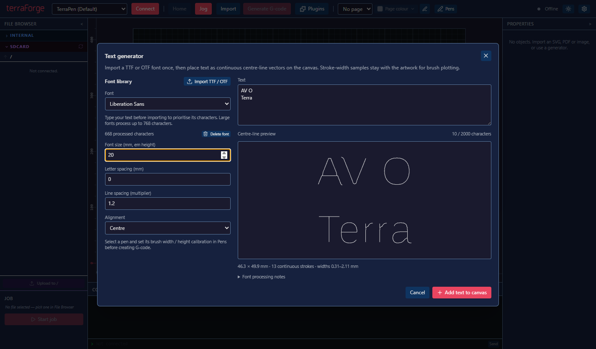
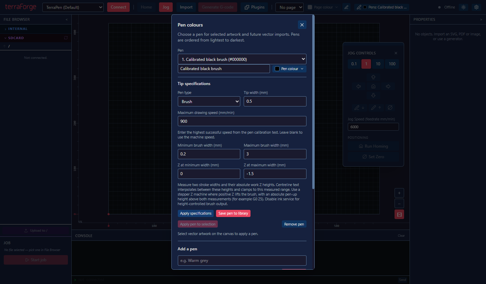

# Fonts, text and reusable pens

Open **Plugins → Font Tools → Text generator** to import a local `.ttf` or `.otf` font. Terra Forge processes it into centre-line geometry, measures the stroke width along each line, and saves the result in the local font library. The original font is read without being changed. The processed library remains available when you close a layout or restart Terra Forge.

Choose the processed font, enter your text, and adjust the size, letter spacing, line spacing and alignment. Size is the font's em height in millimetres, so the visible capital height depends on the font. The preview shows the continuous vector lines and reports their size and stroke-width range. Unsupported characters are listed; adding text is disabled until every character is available.

**Add text to canvas** creates ordinary vector artwork using the currently selected pen. Move, rotate or resize it with the existing canvas tools. Select generated text and reopen the Text generator to change its content or settings with **Update selected text**. Updating keeps the artwork's placement and pen assignment. Adding and updating both support Undo.

Save the layout to keep its text settings, geometry and width samples. Existing text can still be plotted if its font is later deleted from the library. To regenerate or edit it, import that font again or choose another one.

## How centre lines are calculated

TrueType quadratic outlines and OpenType/CFF cubic outlines are flattened, filled using the nonzero winding rule, and sampled at 192 pixels per em. A distance field measures local stroke thickness; thinning produces the centre-line graph. Its edges are joined into continuous trails, including loops through junctions, using the minimum number of trails possible for each connected graph without retracing edges. Disconnected marks, such as the dot on an `i`, still need separate pen strokes.

The result is an approximation of the font's medial lines, rather than the original designer's handwriting or an exact reconstruction of the filled outline. Very fine features and complex junctions can change during sampling and simplification. Inspect the preview at the intended plotting size before generating a job. Width samples scale with the text size and canvas transforms.

The first version processes up to 768 mapped Unicode characters per font. Type your text before importing to prioritise those characters; remaining capacity goes to Latin, punctuation and other mapped characters. It preserves advance widths, spaces and supported kerning pairs. It does not perform complex-script shaping, bidirectional text layout, automatic ligatures or variable-font axis selection. Individual fonts report their processing notes in the generator. Text is limited to 2,000 characters and 250,000 sampled points; a font import is limited to 20 MiB and runs in a background worker with a two-minute deadline. Font files and the processed library remain on this computer; use fonts under their applicable licence terms.

## Pen library and brush specifications

Open **Pens**, add or select a pen, and enter its type, colour, tip width and optional maximum drawing speed. Use the highest successful speed from your calibration tests, in millimetres per minute. **Apply specifications** updates the layout pen; **Save pen to library** also makes it reusable in other layouts. The library groups pens by type and colour and provides filters. Select a saved pen and choose **Use saved pen** to add it to the current layout. Saved pens survive closing layouts and restarting the app.

For a brush, enter two measured stroke widths and the absolute work Z heights that produced them. The minimum-width height and maximum-width height may increase or decrease with pressure, depending on your machine setup. Widths must increase from minimum to maximum. Use the same work-coordinate reference as the machine's pen commands.

For centre-line text on a **stepper Z** machine, G-code interpolates a Z height between these two measurements for every width sample. Requested widths outside the measured range clamp to the nearest calibrated endpoint. Drawing speed is capped at the pen's maximum speed. Configure the machine's pen-up command as an absolute work-coordinate `G0` or `G1` Z move above both contact heights; increasing Z must lift the brush. Brush height control cannot be combined with ink-service moves in this version. Fixed tips draw the centre line at their physical tip width; they cannot reproduce variable width from pressure.

Choose and calibrate the pen before generating G-code. The generated text retains its width samples through layout saving, resizing, rotation, clipping and path ordering, allowing another calibrated brush to be selected later without reprocessing the font.

## Verification

Verified on Windows on 29 October 2026:

- `npm run typecheck` and `npm run build` passed, including the packaged font-worker entry.
- All 2,373 unit/component tests passed using `npx vitest run --maxWorkers=4 --testTimeout=15000`. Windows directory-link tests require permission to create junctions.
- All 14 selected desktop checks passed across `font-library`, `pen-library`, `plugins-menu`, `gcode-generation` and `white-pen`. These cover native TTF import, preview, editable text, undo, saved geometry, library restart persistence, calibrated brush Z output and speed limits.
- Font engine tests cover real TrueType outlines, serialized OpenType/CFF cubic outlines, counters, kerning, disconnected components, continuous trails and prioritised Unicode characters.

These checks validate generated output and desktop behaviour. No physical plotter motion was performed; brush endpoint measurements must come from the actual pen and machine.
