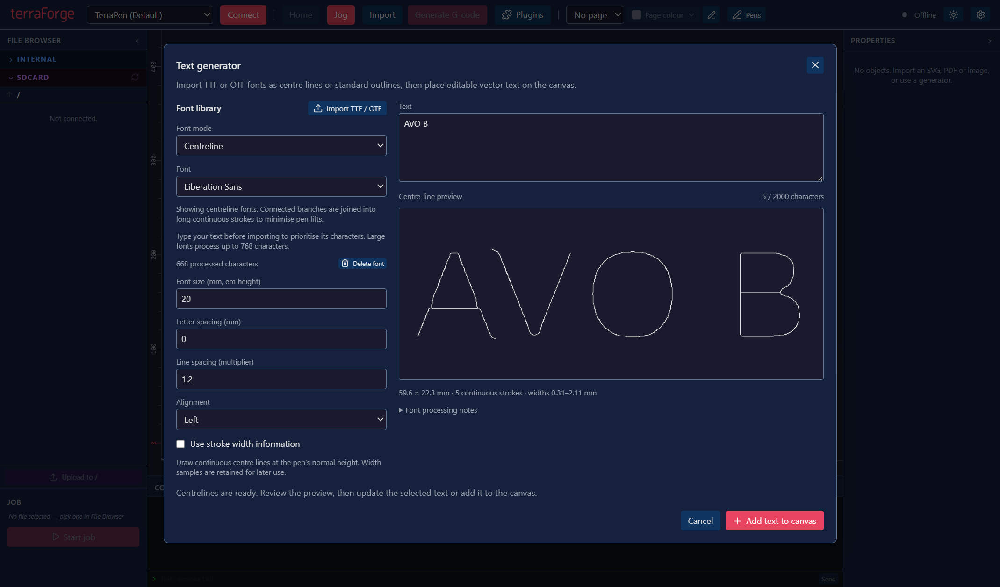
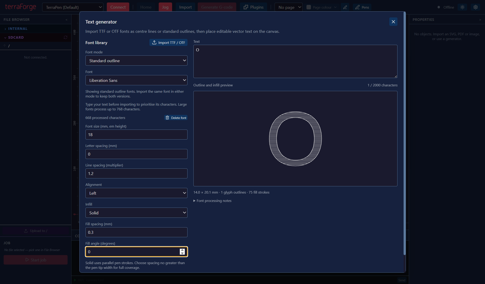
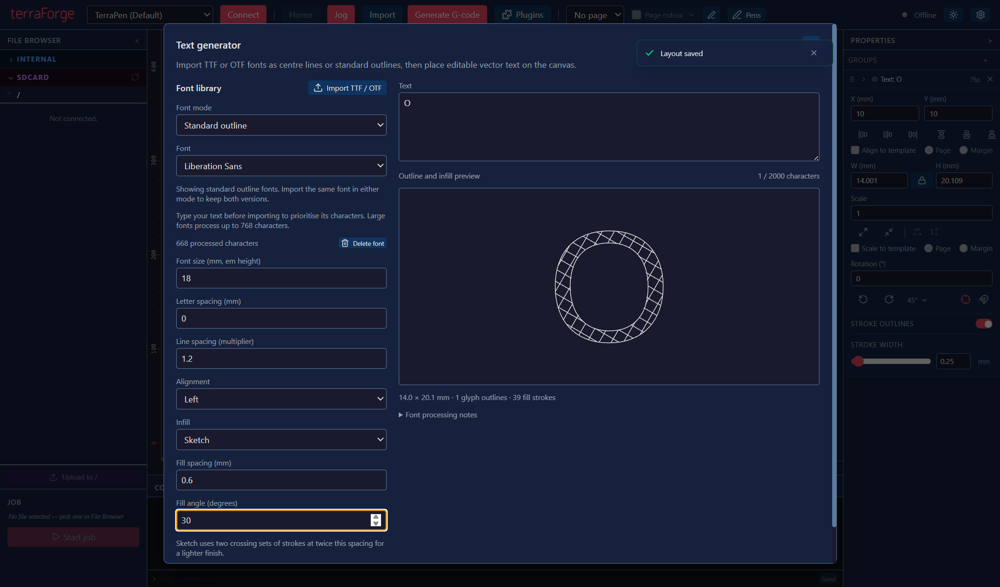

# Fonts, text and reusable pens

Open **Plugins → Font Tools → Text generator** to import a local `.ttf` or `.otf` font. Choose **Centreline** or **Standard outline** in **Font mode** before importing. Centreline processing measures local stroke widths; Standard outline imports the original glyph contours without skeletonising them. The original font is read without being changed. Each version is saved separately in the local font library, and the font selector shows versions matching the current mode. The library remains available when you close a layout or restart Terra Forge.

Choose the imported font, enter your text, and adjust the size, letter spacing, line spacing and alignment. Size is the font's em height in millimetres, so the visible capital height depends on the font. The preview shows the actual vector strokes that will be plotted. Unsupported characters are listed; adding text is disabled until every character is available.

**Add text to canvas** creates ordinary vector artwork using the currently selected pen. Move, rotate or resize it with the existing canvas tools. Select generated text and reopen the Text generator to change its content or settings with **Update selected text**. Updating keeps the artwork's placement and pen assignment. Adding and updating both support Undo.

Save the layout to keep its text settings, geometry and width samples. Existing text can still be plotted if its font is later deleted from the library. To regenerate or edit it, import that font again or choose another one.

## Generate centrelines from an imported font

Select an imported **Standard outline** font, then choose **Centreline** in **Font mode**. Terra Forge generates long continuous centre-line strokes and measures their widths from the saved glyph contours. You can also use **Generate centrelines** beside the selected outline font. The original font file is not needed, and the outline version stays in the library.

The generator automatically selects the centreline version and displays its text preview. Your text, size, spacing and brush settings remain in place. Switching back to **Standard outline** selects the corresponding original font; switching to **Centreline** again reuses the generated version. A conversion error leaves the current font and preview selected.

Review the preview, then choose **Add text to canvas** or **Update selected text** to apply it. Conversion itself does not change canvas artwork. Connected branches and loops are joined to keep strokes long and minimise pen lifts; separate marks still require separate strokes.

## Standard outlines and infill

**Standard outline** keeps the font's native quadratic or cubic curves and all contours, including the holes in letters such as `O` and `B`. It uses the selected pen's normal drawing height. Choose an **Infill**:

- **Outline** plots the glyph boundaries only.
- **Solid** adds parallel drawing strokes clipped to the glyph interior. Set **Fill spacing** no greater than the physical pen tip width for full coverage. The default is 0.3 mm; adjust it for the actual pen and material.
- **Sketch** adds two crossing sets of drawing strokes at twice the chosen spacing for a lighter finish.

**Fill angle** rotates the fill strokes. The preview contains the generated strokes, and those same strokes are saved with the artwork and passed to G-code generation. Counters remain empty, and overlapping contours follow the font's nonzero winding rule. Filled text also includes its boundaries. Changing text size or fill settings in the generator rebuilds the strokes; ordinary canvas resizing scales existing strokes and their spacing together. Very large or dense fills are rejected before generation when they exceed the processing budget.

## Centreline width control

New centreline text draws at the pen's normal height by default. Enable **Use stroke width information** to vary a calibrated brush's height using the measured widths. A fixed pen tip keeps its normal height even with this option enabled. Turning the option off preserves all measured widths, allowing it to be enabled later without reprocessing the font.

With width control enabled, **Brush lead-in** sets a moving approach before each brush stroke, from 0.1 to 20 mm (default 1 mm). The brush descends while travelling into the stroke, reaching the calibrated drawing height at its first point; it does not press down and dwell at a stationary starting point. Contact can begin during the approach and leave a short mark before the glyph, so keep space around the text. G-code generation reports an error if the lead-in would extend outside the printable area. Existing layouts without an explicit width-control setting continue to use their measured widths and now receive a moving brush approach.

## How centre lines are calculated

TrueType quadratic outlines and OpenType/CFF cubic outlines are flattened, filled using the nonzero winding rule, and sampled at 192 pixels per em. A distance field measures local stroke thickness; thinning produces the centre-line graph. Its edges are joined into continuous trails, including loops through junctions, using the minimum number of trails possible for each connected graph without retracing edges. Disconnected marks, such as the dot on an `i`, still need separate pen strokes.

Tracing favours the longest physical strokes first. Branch-only components use the longest remaining path, so a long stem is kept whole instead of being split into shorter balanced strokes. Components containing loops compare up to sixteen deterministic trail arrangements and keep the longest-first result. This bounded search aims for long continuous strokes while retaining complete coverage and minimum pen lifts; complex branching loops are not guaranteed a globally longest arrangement. Previously processed centreline fonts retain their saved geometry; reimport those fonts to apply the improved tracing.

The result is an approximation of the font's medial lines, rather than the original designer's handwriting or an exact reconstruction of the filled outline. Very fine features and complex junctions can change during sampling and simplification. Inspect the preview at the intended plotting size before generating a job. Width samples scale with the text size and canvas transforms.

The first version processes up to 768 mapped Unicode characters per font. Type your text before importing to prioritise those characters; remaining capacity goes to Latin, punctuation and other mapped characters. It preserves advance widths, spaces and supported kerning pairs. It does not perform complex-script shaping, bidirectional text layout, automatic ligatures or variable-font axis selection. Individual fonts report their processing notes in the generator. Text is limited to 2,000 characters and 250,000 sampled points; a font import is limited to 20 MiB and runs in a background worker with a two-minute deadline. Font files and the processed library remain on this computer; use fonts under their applicable licence terms.

## Pen library and brush specifications

Open **Pens**, add or select a pen, and enter its type, colour, tip width and optional maximum drawing speed. Use the highest successful speed from your calibration tests, in millimetres per minute. **Apply specifications** updates the layout pen; **Save pen to library** also makes it reusable in other layouts. The library groups pens by type and colour and provides filters. Select a saved pen and choose **Use saved pen** to add it to the current layout. Saved pens survive closing layouts and restarting the app.

For a brush, enter two measured stroke widths and the absolute work Z heights that produced them. The minimum-width height and maximum-width height may increase or decrease with pressure, depending on your machine setup. Widths must increase from minimum to maximum. Use the same work-coordinate reference as the machine's pen commands.

For centre-line text with **Use stroke width information** enabled on a **stepper Z** machine, G-code interpolates a Z height between these two measurements for every width sample. Requested widths outside the measured range clamp to the nearest calibrated endpoint. The brush lowers through its moving lead-in before each stroke. Drawing speed is capped at the pen's maximum speed. Configure the machine's pen-up command as an absolute work-coordinate `G0` or `G1` Z move above both contact heights; increasing Z must lift the brush. Brush height control cannot be combined with ink-service moves in this version. Fixed tips draw the centre line at their physical tip width; they cannot reproduce variable width from pressure.

Choose and calibrate the pen before generating G-code. The generated text retains its width samples through layout saving, resizing, rotation, clipping and path ordering, allowing another calibrated brush to be selected later without reprocessing the font.

## Verification

Centreline mode selection and longest-first tracing verified on Windows on 30 October 2026:

- Build and type checks passed; all **2,440 unit/component tests** passed.
- All **four selected desktop checks** passed across `font-centreline-conversion`, `font-library` and `font-brush-lead-in`. The reported outline-to-centreline switch now converts the selected saved font and keeps the text preview populated, without another file picker.
- Tracing tests verify full stems, physical stroke length, rotated/reflected branches, closed loops, minimum trail counts and exact coverage without retracing or invented connections. Conversion tests preserve original outlines, advance widths, kerning, spaces and library files.

Font modes, infill, optional width control and moving brush approaches verified on Windows on 30 October 2026:

- Build and type checks passed. All **2,415 unit/component tests** passed with controlled parallelism and a 15-second per-test timeout.
- All **13 selected desktop checks** passed across `font-library`, `font-brush-lead-in`, `pen-library`, `gcode-generation` and `white-pen`.
- Real-font desktop exports verified changing brush Z with a 2 mm moving approach, capped drawing speed, switching back to fixed-height plotting, native outline import, Solid/Sketch plot geometry, saved settings and reopening.
- Geometry tests verify counters and overlapping contours, continuous infill spans, native TTF/OTF curves, clipping, reversed strokes, lead-in bounds and no brush contact dwell.

Initial font and pen-library implementation verified on Windows on 29 October 2026:

- `npm run typecheck` and `npm run build` passed, including the packaged font-worker entry.
- All 2,373 unit/component tests passed using `npx vitest run --maxWorkers=4 --testTimeout=15000`. Windows directory-link tests require permission to create junctions.
- All 14 selected desktop checks passed across `font-library`, `pen-library`, `plugins-menu`, `gcode-generation` and `white-pen`. These cover native TTF import, preview, editable text, undo, saved geometry, library restart persistence, calibrated brush Z output and speed limits.
- Font engine tests cover real TrueType outlines, serialized OpenType/CFF cubic outlines, counters, kerning, disconnected components, continuous trails and prioritised Unicode characters.

These checks validate generated output and desktop behaviour. No physical plotter motion was performed; brush endpoint measurements must come from the actual pen and machine.
