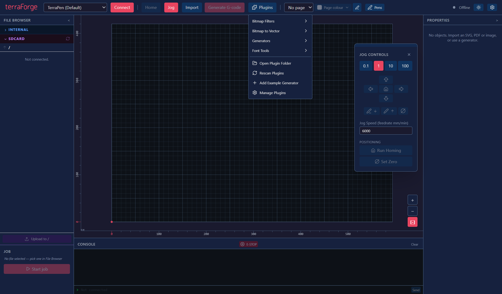
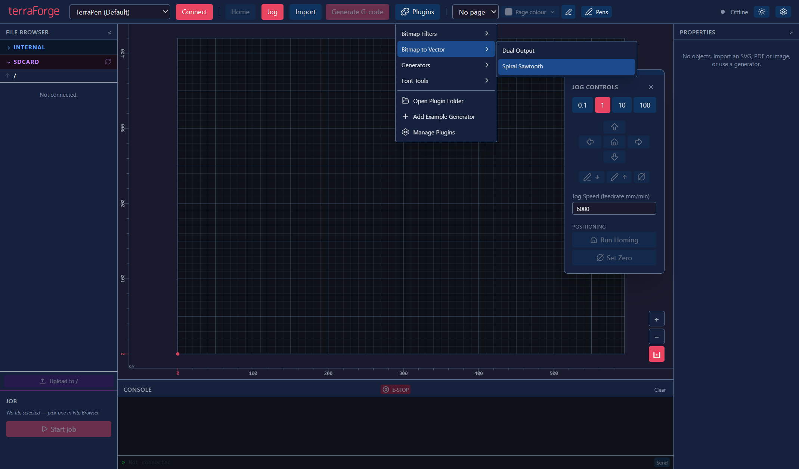

# Plugins menu

Click **Plugins** to open four vertically stacked categories. Hover over or click a category to open its plugin submenu beside it. The category stays highlighted and visible while you move into the submenu; switching categories replaces that submenu. Submenus normally open to the right and flip left when the window edge leaves insufficient room. Long plugin lists scroll within the menu.

## Categories

The menu reads each installed plugin's existing metadata. No plugin-file changes are required.

| Category | Installed tools shown here |
| --- | --- |
| **Bitmap Filters** | Bitmap input with bitmap output, such as Bitmap Tones. |
| **Bitmap to Vector** | Bitmap input with vector output, including Bitmap Scanlines and Spiral Sawtooth. |
| **Generators** | Existing generators and vector-input processors. Vector processors show a **Vector input** label. |
| **Font Tools** | Plugins explicitly categorised as font tools. This category takes precedence over input/output grouping. |

A bitmap plugin supporting both bitmap and vector output appears in both bitmap categories. Empty categories show **No plugins installed in this category.** Disabled tools explain that they can be enabled in **Manage Plugins**.

Choose a plugin to close the menu and open its existing **Properties** controls. Bitmap and vector processors still require one matching source item; Properties explains a missing or unsuitable selection and disables Preview until it is valid. Continue with **Preview → Apply artwork**, or reopen applied artwork through **Edit with** and use **Update artwork**. Minimise, close, saved settings and the processing workflow work as before.

## Utilities and management

A separated section beneath the categories retains **Open Plugin Folder**, **Rescan Plugins**, **Add Example Generator** and **Manage Plugins**. Add Example Generator installs the existing grid example and opens its Properties controls. Manage Plugins contains enable/disable controls and per-file errors. Use **Rescan Plugins** to discover new or edited files without restarting; enable only plugins you trust.

## Keyboard and dismissal

With the menu open, **Up/Down** moves through entries, **Right** enters the highlighted category's submenu and **Left** returns to the categories. **Enter** opens a category or selects a plugin. **Escape** closes the menu; clicking outside closes the complete cascade.

## Verification

Verified on Windows against the Electron desktop build based on merged Spiral Sawtooth PR #7:

- Type checks, production build and targeted lint checks passed.
- All 1,918 unit/component checks passed across 172 files.
- All 21 targeted desktop scenarios passed, covering mouse/keyboard menus, long-list scrolling, left-side collision placement, empty categories, plugin management, generator settings, Stage 3 processing, actual Spiral Sawtooth preview/apply/update/save/reopen, and page/pen colours. The vector-input scenario was rerun successfully after updating its test navigation to Generators.
- Native desktop inspection confirmed mouse category selection, Right/Down/Enter selection of Spiral Sawtooth, complete menu dismissal and existing Properties controls with the missing-bitmap explanation.

Desktop checks used disposable profiles and plugin directories. The screenshots above show the real desktop build with test fixtures and the actual Spiral Sawtooth plugin. Existing installed plugins and user settings were left intact. No physical plotter was operated.
