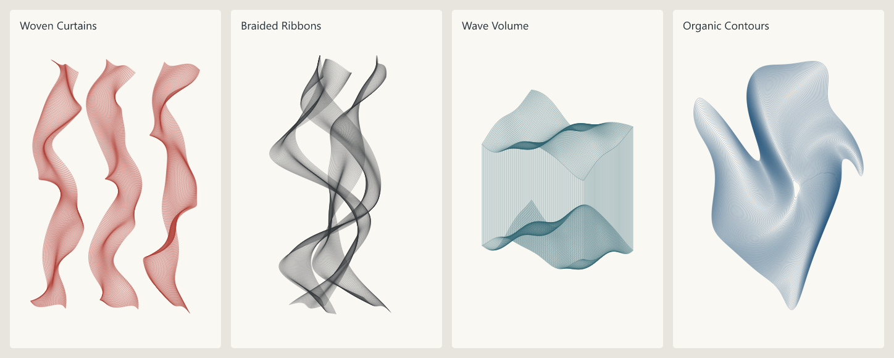
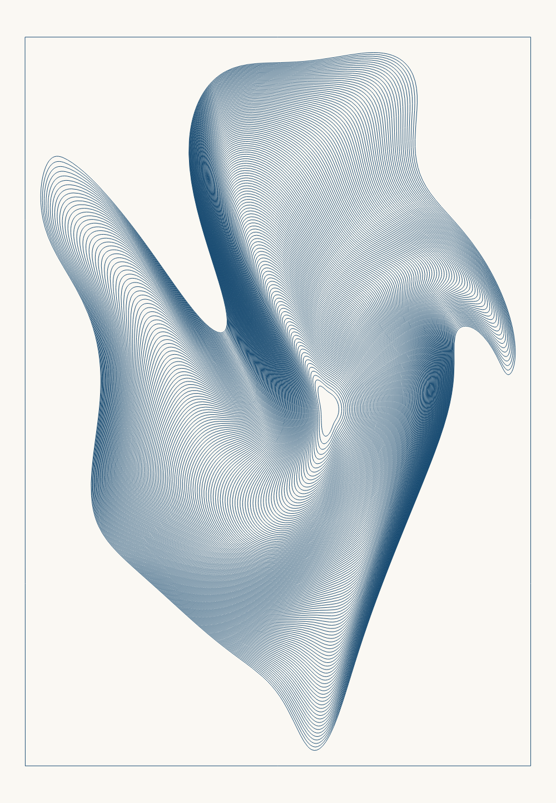

# Sculptural Generators 1.0.0 — border update

Three original vector generators for the `shaboomi/terraForge` fork: **Flowing Ribbons**, **Wave Volume** and **Organic Contours**. They interpret the broad visual ideas in the supplied pen-plot photographs. They do not trace those images or reproduce the artists' algorithms. No reference photographs are included in the distribution.

Every visible mark is an ordinary editable, opaque vector stroke. The SVG previews contain no filled artwork, bitmap shading, opacity effects or gradients. Dense regions come from closely spaced or crossing strokes.

## Install — no GitHub steps needed

1. Extract **Sculptural-Generators-1.0.0-border-update.zip** using Windows **Extract All**.
2. Open your TerraForge fork. Choose **Plugins → Open Plugin Folder**.
3. Copy these three files from the extracted **plugins** folder into the folder TerraForge opened:
   - `flowing-ribbons.tf-plugin.js`
   - `wave-volume.tf-plugin.js`
   - `organic-contours.tf-plugin.js`
4. Choose **Plugins → Rescan Plugins**. Enable the plugins if necessary.
5. Choose **A4 Portrait**, then **Plugins → Generators → Flowing Ribbons**, **Wave Volume** or **Organic Contours**. You do not need to select any existing artwork.
6. Leave the defaults for a first try. Click **Preview**, inspect it, then **Apply artwork** to keep it.

The plugin files are self-contained; you do not install JavaScript packages or copy the build scripts. The app opens the correct plugin folder for installed or development mode. Keep existing plugins in that folder. If you previously installed another copy of one of these three new generators, replace that file; duplicate IDs are unavailable until the duplicate is removed.

For the border update, replace the three previously installed files with the new copies, then Rescan Plugins. Existing layouts remain editable because the plugin IDs and declared version are unchanged; the app discloses the changed code before an explicit Preview/Update. Existing settings gain the two new border controls with their defaults. If an older result used a border at the margin, choose **At artwork margin (original)** to retain that placement when updating.

Use the current plugin-capable build of this fork. A Windows directory build used for verification is under `release/sculptural-generators/win-unpacked`. It is an unsigned local verification build, not a new installer. These plugins require no engine changes and do not change menus, paper settings, machine configuration or other plugins.

## Preview, keep and edit

Preview is temporary: it cannot be saved, exported or plotted. **Cancel preview** discards it; closing the panel also discards it. Minimising the panel keeps a valid preview. Changing a setting, page or pen palette invalidates it, so Preview again before applying. **Cancel plugin** stops a running calculation and adds nothing.

Apply adds the entire composition in one undoable operation. Multi-pen artwork may appear as several items named, for example, `Wave Volume — Blue pen`; these belong to the same generated composition. One Undo removes the whole composition. Redo restores it.

To regenerate existing artwork, select any item in that composition and choose **Edit with [plugin name]** in Properties. Change settings, Preview, then **Update artwork**. The entire composition updates together, preserving its placement and one-step Undo/Redo. Opening the generator from the Plugins menu starts a new composition instead.

Save a `.tforge` layout to retain the full frame, paths and every setting, including **Random seed** and **Variation strength**. Reopen it and use Edit with to restore the controls. Keep the same plugin version installed to regenerate. Opening a layout does not run code. Regeneration replaces any manual edits to those generated paths.

## Four starting compositions

All four use a **180 × 260 mm** frame, **12 mm** margins, **0°** orientation, **seed 42**, **Variation strength 1**, **Sampling tolerance 0.045 mm**, no border and primary pen position 0.

| Preview | Generator and settings | Paths / points |
| --- | --- | --- |
| [Woven Curtains](images/sculptural-generators/woven-curtains.png) · [editable SVG](images/sculptural-generators/woven-curtains.svg) | Flowing Ribbons defaults; colour `#aa362c` | 882 / 31,049 |
| [Braided Ribbons](images/sculptural-generators/braided-ribbons.png) · [editable SVG](images/sculptural-generators/braided-ribbons.svg) | Flowing Ribbons: Composition preset **Braided Ribbons**, Crossweave **0**, colour `#292b30`; other defaults | 174 / 17,128 |
| [Wave Volume](images/sculptural-generators/wave-volume.png) · [editable SVG](images/sculptural-generators/wave-volume.svg) | Wave Volume defaults; colour `#235a67` | 575 / 23,163 |
| [Organic Contours](images/sculptural-generators/organic-contours.png) · [editable SVG](images/sculptural-generators/organic-contours.svg) | Organic Contours defaults; colour `#164970` | 135 / 21,483 |

Each preview also has a matching `.json` file recording all parameter values. This is a settings reference; the current Properties panel has no JSON preset-import button. Use the table for the four starting looks, or consult the JSON when matching every value. The ribbon preset selector changes its underlying surface model while retaining the values of the other controls.

For a ready-to-edit starting point, open the matching **`.tforge`** file from the package's **previews** folder with TerraForge's **Open layout** command. Each contains the complete vector composition and saved plugin settings. Select the artwork and choose **Edit with** to continue. Opening a layout replaces the current canvas after confirmation, so save existing work first. The preset files introduce no fictitious configured pens; their primary pen position is 0. The plugin must be installed to reopen its controls, while the saved vectors remain usable without it.

The PNGs are rendered from these actual SVG paths at a uniform 0.18 mm stroke width. Their cream background represents paper; it is absent from the plottable SVG. Apparent darkness will vary with your real ink, nib and paper.

TerraForge's normal canvas uses a 0.5 mm display stroke by default, which can visually merge these dense lines. The supplied `.tforge` presets use **Stroke width 0.18 mm** for display. For newly applied artwork you can select it, close/minimise the plugin panel, and set **Stroke width value** in its normal Properties. This display setting does not change the paths or G-code.

## Controls shared by all three

| Control | Default | Effect |
| --- | --- | --- |
| Artwork width / height | 180 / 260 mm | Declared full frame, including blank margins. Must fit the current page. |
| Margin | 12 mm | Inset for the generated artwork. Geometry outside this area is genuinely clipped into separate paths. An artwork-relative border may occupy part of this blank inset. |
| Artwork orientation | 0° | Rotates the composition about its frame centre. Rotation can crop artwork at the inset; the frame dimensions stay unchanged. Use the normal canvas placement controls after applying to move or rotate the entire frame without this crop. |
| Random seed | 42 | Editable integer, 0–2,147,483,647. Same settings and seed give the same geometry. |
| Variation strength | 1 | Changes seeded smooth phase variation. At 0, changing seed has no effect. It does not independently jitter each line. |
| Sampling tolerance | 0.045 mm | Maximum target curve-to-polyline deviation estimated by adaptive subdivision. Smaller values use more points. Changes smoothness without changing the underlying form. This is separate from line density and physical plotter speed. |
| Stroke colour | `#183d53` | One source colour when Primary pen position is 0. Has no effect on geometry. An explicitly assigned real pen uses that pen's colour. |
| Primary pen position | 0 | 0 uses Stroke colour; 1 uses the first currently configured pen, 2 the second, and so on. See pen assignment below. |
| Add border | Off | Adds one closed rectangle in the primary pen/colour, without joining it to the artwork. |
| Border placement | Around artwork | Rectangle around the visible artwork's bounding box. Choose **At artwork margin (original)** for the original fixed frame inset. |
| Border gap from artwork | 5 mm | In **Around artwork** mode, distance from each bounding-box side to the border's stroke centre-line. Ignored in the original margin mode. 0 touches the artwork's outer extents. |
| Artwork capacity (host control) | Standard | Standard allows 10,000 paths / 100,000 points / 30 seconds. Extended 6× allows 60,000 / 600,000 / 180 seconds. |

Width and height are frame dimensions, not a scale factor for every physical control. When changing paper size, also adjust ribbon widths, wavelengths or the volume footprint if needed. Organic Contours fits its outer envelope to the available frame before orientation is applied.

### Add a border with a chosen gap

Tick **Add border**, leave **Border placement** at **Around artwork**, and set **Border gap from artwork** in millimetres. For example, **5 mm** puts the four border sides 5 mm beyond the left, right, top and bottom extents of the visible paths. The rectangle surrounds the complete composition, including all ribbons and pen families, and stays upright after Artwork orientation is applied. It does not trace individual folds. The gap measures path centre-lines; a thick physical nib reduces the visible white space slightly.

Changing the gap leaves every artwork path and the declared width/height untouched. The border must fit inside that full frame; it may extend into the artwork's Margin. A gap that is too large produces an error with the available distance, rather than clipping the border, resizing the composition or returning an incomplete result. Reduce the gap or increase **Margin** to make room. With **At artwork margin (original)**, the border is instead inset exactly by Margin from the four frame edges, regardless of Border gap.

The border shares the primary pen/colour and belongs to the same Preview/Apply/Update and Undo/Redo operation. Its checkbox, placement and distance are saved with the result. A separate border plugin would be useful for unrelated imported artwork; these generators already have the composition bounds needed to keep their own border aligned on regeneration.

### Assign configured pens

The current API makes every `pen` dropdown mandatory, even when an algorithm would not use it. To support immediate single-colour defaults without an engine update, these plugins use **pen positions** instead. Read the current ordered list in **Pens**; positions are 1-based in that list. The plugins resolve each position against `input.palette` and return its actual configured **pen ID**. They never invent IDs or reorder the palette. An unavailable position gives an error.

For example, if Pens lists Red, Blue, Black, primary position **2** assigns Blue. For two-family ribbons, choose **Primary strands / crossweave pens**, primary **2**, crossweave **1**. For a three-pen volume, choose **Upper / lower / connecting strand pens**, primary **1**, lower **2**, connecting **3**. Secondary position 0 inherits the primary assignment. In **Configured pens by ribbon** mode, ribbon 1 uses palette pen 1, ribbon 2 uses pen 2, and so on, cycling if there are fewer pens than ribbons.

Saved output retains the host's actual pen assignments and normal export behaviour. The settings store pen **positions**, so check them before regenerating if you added, removed or recoloured pens: TerraForge may reorder its palette by colour. Leave positions at 0 to use one source colour, then use the normal pen workflow. Different pen assignments and colours do not rearrange geometry.

These are ordinary pen groups, with no forced pass order. Existing combined export can optimise travel across colours and retains colour metadata; it does not automatically pause for a manual pen change. For separate physical pens, use **Generate G-code → Output → Split output into separate files → Export one file per group**, then run the files in your intended pen order through the normal workflow. No new automatic pen changing or plot commands are introduced.

## Flowing Ribbons

Long strands hold one ribbon coordinate fixed and travel along a shared smooth surface. Crossweave curves travel across the same surface. Woven Curtains offsets the ribbon centres into separated columns; Braided Ribbons brings them together and rotates their cross-sections. Crossings and folded projections are deliberate. Separate ribbons and strands never receive pen-down connector strokes.

| Control | Default | Useful range / behaviour |
| --- | --- | --- |
| Composition preset | Woven Curtains | Three separated ribbons; choose Braided Ribbons for overlapping folds and large openings. |
| Ribbon count | 3 | 1–12; adding ribbons may require a wider frame or smaller widths/separation. |
| Ribbon width | 34 mm | Width of the undeformed cross-section; twisting changes its apparent projected width. |
| Ribbon separation | 18 mm | Edge gap for straight curtains. In braid mode it controls a reduced centre offset (55% per ribbon step), allowing overlap. |
| Line spacing across ribbon | 0.6 mm | Spacing in the undeformed ribbon coordinate; local compression makes dark folds. Increase for fewer lines. The two edges are included. |
| Bend strength / wavelength | 9 / 90 mm | Larger strength increases sideways drift. A shorter wavelength adds folds along the height. |
| Twist amount | 1.1 | Rotates cross-sections; 0 removes this rotation. Higher values add narrow projected folds. |
| Phase variation between ribbons | 1 | Controls the phase offset between ribbons. 0 makes their periodic features more alike. |
| Crossweave amount | 0.65 | 0 disables the second family exactly. Higher values add transverse curves; braid mode uses 28% of the curtain rate. |
| Smooth irregularity strength / scale | 2 / 110 mm | Low-frequency coherent drift; strength is multiplied by Variation strength. Larger scale makes broader changes. |
| Pen assignment | Single pen / colour | Single; configured pens by ribbon in current palette order; or primary/crossweave families. |
| Crossweave pen position | 0 | 0 inherits primary; otherwise choose a current configured-pen position. |

Try curtains with count **3**, width **30–36 mm**, separation **18–24 mm**, twist **0.7–1.2**, crossweave **0.4–0.8**. For the open braid use the preview recipe above; increase Twist to **1.4** for more crossings or use spacing **0.4 mm** for darker folds. Wider ribbons and stronger bends can overlap or clip; increase frame width or reduce them if you want more white space.

## Wave Volume

Upper and lower surfaces share a seeded height field. They use a common broad component plus phase-shifted waves; their gap stays positive. Orthographic projection turns them into a transparent wire sculpture. Long straight strands join matching positions on the two camera-facing outside edges. When the hollow option is on, surface curves split at the elliptical hole and a full inner wall of connecting strands is added.

| Control | Default | Effect |
| --- | --- | --- |
| Footprint width / depth | 112 / 78 mm | Physical X/Y footprint before projection. |
| Vertical surface separation | 105 mm | Nominal world-space Z gap. Increasing it lengthens the strands. |
| Wave amplitude / wavelength | 22 / 85 mm | Physical relief and broad wave scale. Differential relief is capped at 60% of separation, preserving at least 10% positive gap; the common broad relief remains available. |
| Surface complexity | 3 | 1–6 coherent harmonics; higher values add surface detail. |
| Upper/lower phase difference | 125° | Moves lower features relative to the upper ones without creating unrelated noise. |
| Strand spacing (also surface grid) | 1 mm | One density control for footprint surface grids and connecting strands, before projection. |
| Projection azimuth / elevation | 35° / 30° | Turns the footprint and changes the viewing elevation. Higher elevation reveals more depth and shortens the projected vertical strands. |
| Show upper / lower / connecting strands | All on | Each family can be independently hidden. Keep strands on for the reference's volume effect. All off gives an explanatory error. |
| Hollow centre | 0% | 0 is solid. Up to 65% removes a concentric ellipse from both surfaces. Percentage is of both footprint half-axes. |
| Pen assignment | Single pen / colour | Single or separate upper/lower/connecting families. |
| Lower / connecting pen positions | 0 / 0 | Inherit primary or choose configured positions. |

Projection convention: azimuth 0° puts footprint X horizontally on the page. Screen X = cos(azimuth) X − sin(azimuth) Y; screen Y = sin(elevation) [sin(azimuth) X + cos(azimuth) Y] − cos(elevation) Z. The side with positive camera depth is treated as facing the viewer, so the visible strand edges switch predictably as azimuth crosses a quadrant. There is no hidden-line removal: rear surface grid lines remain visible, just as other ordinary strokes do. Shared side corners are drawn once.

For a more open piece, try spacing **1.5 mm**, complexity **2**, amplitude **18 mm**. For a hollow tower, start with Hollow centre **35%** and leave all three families visible. Large amplitude with a tiny separation is deliberately limited; increase separation to recover stronger differences between the surfaces. A small frame or extreme orientation can crop the projection at the margins.

## Organic Contours

The sole density control is Contour count. Each closed curve samples the same field: positive lobe scaling, a smooth positive pinch, radial twist, then two smooth Cartesian shears. These transformations are invertible, so the continuous contours stay nested. A final positive stretch sets the shape's bounding aspect ratio. The outer-envelope measurement uses a fixed resolution independent of contour count, tolerance, colour and seed stream consumption.

| Control | Default | Effect |
| --- | --- | --- |
| Contour count (density) | 135 | 8–700 nested closed curves; includes inner and outer contours. |
| Base aspect ratio | 0.68 | Width/height of the fitted, unrotated outer envelope. |
| Inner opening | 7% | Minimum underlying radius; at least 1% avoids a collapsed centre path. |
| Lobes / lobe strength | 3 / 0.55 | Number and prominence of broad radial bulges. |
| Warp strength / scale | 0.65 / 3.4 | Shear magnitude and field frequency; larger scale creates more local folds. Scale is dimensionless in the normalized shape field. |
| Twist | 0.65 | Radius-dependent rotation; negative values reverse it. |
| Pinch strength / position | 0.55 / −0.15 | Positive narrowing about a horizontal band. Position −1 is top and +1 bottom in the field before twist, warp and artwork orientation. |
| Spacing bias | −0.15 | Negative values concentrate curves near the outside; positive values concentrate them near the inside. It changes radial distribution, not the field. |

Try a softer form with warp **0.35**, twist **0.3**, pinch **0.35**. For a tighter fold use pinch **0.7**, warp **0.8**, bias **0.1**, keeping the default count initially. Large warp, twist, lobe count and density can require finer sampling and Extended capacity. Analytic nesting does not guarantee separation of coarse polyline approximations at every extreme setting: lower the tolerance when packing many lines into a very narrow fold. Rotation may clip closed contours into separate open fragments.

## Limits and practical plotting

The four supplied previews fit Standard capacity. Limits are checked before large allocations and during calculation, including clipped fragments and border points. Runs report progress and yield regularly for cooperative cancellation. The host also terminates cancelled or expired calculations. An over-budget run reports settings to reduce and returns no partial composition. Extended capacity is explicitly selected in Properties and saved by the existing host.

Adaptive sampling estimates deviation at quarter/mid/three-quarter points and also limits straight segment length to 5 mm; base sampling is increased with the field's frequency. It is an approximation, not a formal bound for every extreme combination. No samples are clamped onto the page edge: Liang–Barsky clipping calculates segment intersections and splits disconnected fragments. Surface holes are split analytically in footprint coordinates. There are no arbitrary pen-down joins or repeated boundary strokes.

If a special parameter combination projects components onto the identical stroke, redundant same-ink copies are omitted. Reversed strokes and closed paths with shifted start vertices are recognised at 0.00000001 mm coordinate precision. Deliberate crossings and different real-pen assignments remain separate.

Physical speed, acceleration and pen pressure remain in TerraForge's machine/pen workflow. These plugins do not operate or connect to a plotter. Keep any optional path-joining optimization disabled when you want the separate strands preserved exactly. Overlapping strokes are intentional, so a thick wet pen may merge dense folds; increase line/strand spacing or reduce contour count to suit your ink.

## Developer reproduction

Canonical source templates and the common bundled geometry helper are in `scripts/lib/sculptural-generators/`. Rebuild the self-contained files with `node scripts/build-sculptural-generators.mjs`, then regenerate actual SVG/PNG/settings previews with `node scripts/preview-sculptural-generators.mjs`. `node scripts/package-sculptural-generators.mjs` prepares the distribution folder under `release/sculptural-generators/`; compress that folder with Windows Compress-Archive.

Geometry and contract tests are in `tests/unit/sculpturalGenerators.test.ts`; real Windows workflows are in `tests/e2e/sculptural-generators.spec.ts`. See [verification](sculptural-generators-verification.md) for the checks completed for this delivery.
