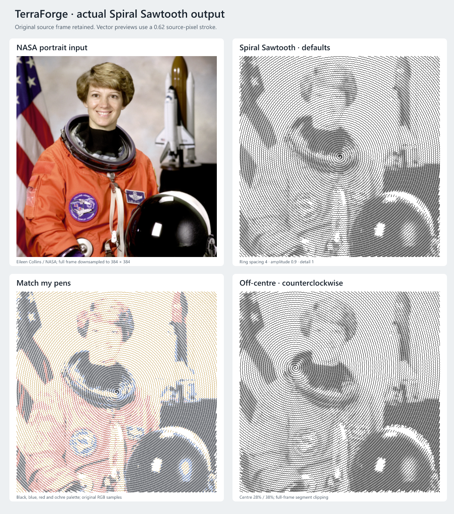
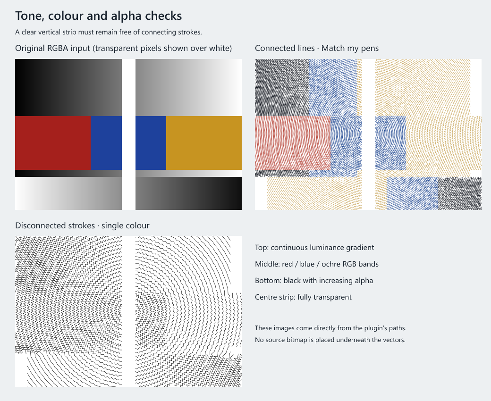

# Spiral Sawtooth

Spiral Sawtooth converts one selected PNG/JPEG bitmap into ordinary editable vector paths. The image remains unchanged, and the generated vectors retain its complete frame, empty margins, position, rotation and separate X/Y scales. It uses the existing Stage 3 plugin engine, including Properties, Preview → Apply, saved settings and whole-result undo/redo.

This is an original JavaScript implementation inspired by the visual behaviour described in [DrawingBotV3's Spiral Sawtooth documentation](https://docs.drawingbotv3.com/en/latest/pfms.html#spiral-sawtooth). It contains no DrawingBotV3 source code or runtime dependencies. Archimedean spirals are supported; Fermat/parabolic spirals are a later extension.

## Install and make your first spiral

You need a TerraForge build containing the merged [Stage 3 PR #6](https://github.com/shaboomi/terraForge/pull/6). This plugin also works with the existing Stage 3 Windows directory build; installing the JavaScript file does not require rebuilding TerraForge.

1. Download [spiral-sawtooth.tf-plugin.js](examples/spiral-sawtooth.tf-plugin.js). On GitHub, open that file and use **Download raw file**. Keep the exact filename, including `.tf-plugin.js`; avoid saving the GitHub webpage or adding `.txt`.
2. Open TerraForge and choose **Plugins → Open Plugin Folder**.
3. Copy the downloaded file into the folder that opens, then completely close and restart TerraForge. The app uses different folders for development and packaged builds, so use its Open Plugin Folder action.
4. Import a PNG or JPEG, select the image itself, and choose **Plugins → Bitmap to Vector → Spiral Sawtooth**. The cascading menu closes and controls appear in **Properties**. Older Stage 3 builds list this plugin under Bitmap Processors.
5. Start with the defaults and choose **Preview**. Scroll within the plugin panel to reach its actions. Preview is temporary and does not add layers or enter saves or plotting.
6. Choose **Apply artwork** to add the complete vector result. The source remains on the canvas. Hide the source with its visibility control when you want to inspect just the vectors.
7. Save a `.tforge` layout. To change an applied result, select one of its vector items and choose **Edit with Spiral Sawtooth**. Change controls, Preview, then **Update artwork**. All pen parts of that result update together, and one Undo restores the preceding result.

Minimising the panel retains its controls and valid preview. Closing it discards the temporary preview and keeps applied artwork. Saved layouts restore parameters through Edit with; keep both the original source item and version 1.0.0 of this plugin to regenerate. Saved vectors remain usable without the plugin. Updating replaces manual edits to generated paths.

No GitHub account action, pull-request merge or package installation is needed to try the file in a Stage 3 app. A pull request is a proposed repository change; merging it adds these examples and tests to the fork, while copying the plugin file installs the tool in your app.

## Controls

| Control | Default | What it changes |
| --- | --- | --- |
| Ring spacing | 4 source pixels | Distance between successive spiral turns. Lower values resolve smaller features and increase work. These are original bitmap pixels, independent of the displayed physical size. |
| Sawtooth amplitude | 0.9 × ring spacing | Maximum peak-to-peak tooth width in opaque black. Teeth get smaller in lighter areas, reaching zero in white. The first turn tapers to the centre. Zero leaves an unmodulated spiral. |
| Tooth frequency / detail | 1 | Larger values place more teeth along the curve. Darker areas also receive more teeth. This is a sampling/detail control, unrelated to machine feed rate. |
| Spiral centre X / Y | 50% / 50% | Origin within the full frame. X=0 is left, Y=0 is top. |
| Extent | 100% | Centreline radius relative to the farthest corner from the chosen centre. 100% covers the frame; smaller values stop sooner. The final half tooth width is included so the last teeth reach the requested radius. |
| Spiral direction | Clockwise | Clockwise or anticlockwise in the image's top-left coordinate system. |
| Tonal contrast | 1 | Contrast around middle grey. Above 1 deepens dark regions and brightens light regions. |
| Tone gamma | 1 | Above 1 strengthens intermediate darkness; below 1 lightens it. |
| Invert tones | Off | Exchanges light/dark before contrast and gamma. Does not invert source colours used to match pens. |
| Skip light areas | On | Removes cells at or above the adjusted brightness threshold. Off retains a baseline spiral through opaque white areas. |
| Skip brightness at or above | 95% | Brightness after inversion, contrast and gamma. Lower thresholds exclude more of the image. 100% skips pure white. Used only when Skip light areas is on. |
| Connected lines | On | Joins adjacent tooth edges where there is no excluded area, clipping exit or pen change. Off lifts between successive tooth edges. |
| Output colour | Single colour | Choose Single colour or Match my pens. |
| Single stroke colour | Black `#000000` | Used in Single colour mode. It is preserved instead of inheriting the currently active pen. |

For Match my pens, first add the actual pens and their colours in **Pens**. Each drawn pixel is compared with the supplied palette using weighted squared sRGB distance. Its path carries the selected real pen ID. Ties use the existing palette order; the plugin does not sort or change pens. Colour matching uses original image colours composited over white, before tone controls. It is an approximation, not calibrated colour separation. An empty palette produces an explanatory error.

Completely transparent pixels are always excluded, including with inversion or light skipping off. Partial alpha is composited over white for tone and colour matching. The source item's display opacity is retained on the unchanged source; it is not baked into generated tones. Choose physical pen width, plot speed and other machine settings in TerraForge's normal plotting controls.

## Example artwork

These previews are rendered from the actual plugin's vectors, with no source bitmap underneath them. The photograph is NASA's public-domain portrait of Eileen Collins; [sources, generation script details and statistics](images/spiral-sawtooth/README.md) are included.



The comparison uses the entire image downsampled to 384 × 384 pixels. Default output has 222 paths / 22,629 points; four-pen output has 7,074 paths / 36,333 points. A full 512 × 512 single-colour portrait also succeeds with defaults (349 paths / 40,231 points). More defined portrait tones can use Ring spacing 3, Gamma 1.3, Contrast 1.2; see [that vector preview](images/spiral-sawtooth/portrait-detail.png).



These illustrations use a stroke width of 0.62 source pixels. Physical pen width and the canvas scale affect the plotted appearance. One uninterrupted path is possible for an opaque, single-colour spiral contained inside the frame, but clipping, ignored cells and multiple pens require breaks. Every change of pen can add a lift.

## How it works and limits

The centreline is an Archimedean spiral, `r = ringSpacing × theta / (2π)`. Arc-length stepping maintains detail toward the outside rings. At each step the plugin bilinearly samples the original pixels composited over white, adjusts darkness, then alternates perpendicular offsets to create sharp teeth. Both amplitude and tooth frequency respond to darkness.

Each tooth edge is clipped against the rectangular image frame using segment intersections. A pixel-cell traversal then splits it at every excluded cell and pen change, including one-pixel slits that endpoint-only sampling could miss. Outside points are not clamped onto the edges. Collinear cell subdivisions may be merged; tooth corners and exclusion breaks remain intact. Pixel coordinates are finally mapped into the complete source-local frame; the host alone applies placement and machine transforms.

The plugin is deterministic, reports progress and checks cancellation. It allows at most 100,000 output points and 10,000 output paths, with additional bounded traversal work and a 25-second internal calculation deadline inside the host's 30-second runtime. Limits cause the whole run to fail with an actionable error; it never returns a truncated spiral. Preview/Apply only sees a complete successful result.

If a budget is exceeded, increase Ring spacing, reduce Tooth frequency / detail or Extent, keep Connected lines on, or use fewer pen colours. A smaller-resolution copy can also help; the plugin itself never resizes or overwrites your source. Highly textured colour photographs and disconnected strokes reach the path budget sooner. For example, the 512-pixel portrait's four-pen configuration exceeds the path budget, while the complete 384-pixel version succeeds. White or wholly transparent images with no eligible marks report an empty-result explanation; disable light skipping or invert an opaque white image to see a spiral.

This is a geometric tonal rendering, not a photographic halftone calibration or edge tracer. Details smaller than the spacing may be lost. Rectangular clipping means full extent normally has multiple path fragments. Larger amplitudes can overlap rings. Fermat/parabolic spirals, adaptive error diffusion and physical colour calibration remain future work.

## Verification — 28 October 2026 (New Zealand)

Tests execute the distributed JavaScript itself and validate it through the Stage 3 result contract. They cover solid black/grey/white, gradients, inversion/contrast/gamma, original colour matching, transparency and partial alpha, one-pixel ignored slits, rectangular/off-centre frames, true clipping, connected/disconnected marks, deterministic progress, cooperative cancellation, elapsed time and point/path budget refusal. Source pixels, palette and placement are checked for mutation.

The final verification passed TypeScript checks, the production build, all **1,901 unit/component checks across 170 files** (including 28 Spiral Sawtooth checks), and ESLint for the new test files. All **nine combined desktop checks** passed: two actual-plugin workflows, five Stage 3 workflows, page/pen colours and white-pen export. Both actual-plugin workflows passed again against the final plugin in the packaged Windows app. Whitespace and JavaScript syntax checks passed.

Actual-plugin desktop tests cover Preview isolation from saved artwork and plotting, full-frame alignment with rotation and unequal scaling, source and asset preservation, real pen assignments/order, selected single colour, minimise/close/reopen, whole-result apply/update Undo/Redo and save/restart/reopen. The same workflows pass against the existing unpacked Windows Stage 3 application, with packaged identity and disposable profiles verified before actions. Actual portrait and diagnostic vector artwork and packaged screenshots were visually inspected.

Reproduce from the repository after installing its development dependencies:

```powershell
npm.cmd run typecheck
npm.cmd test
npm.cmd run build
npx.cmd playwright test --config=tests/e2e/playwright.config.ts tests/e2e/spiral-sawtooth.spec.ts
node scripts/spiral-sawtooth-previews.mjs
npm.cmd run test:spiral-package -- .\release\stage-3\win-unpacked\terraForge.exe
```

The package command accepts the path to another compatible unpacked Windows executable. The NSIS installer, macOS and Linux were not tested for this plugin. No physical plotter was operated.
